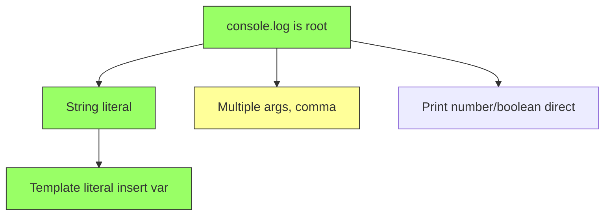

Goal: write basic print statements in TypeScript, confidently.

Links: [[A console.log is root]], [[B String literal]], [[C Template literal]], [[D Multiple args]], [[E Print number boolean]]

Status: teaching node D (multiple args with comma).
