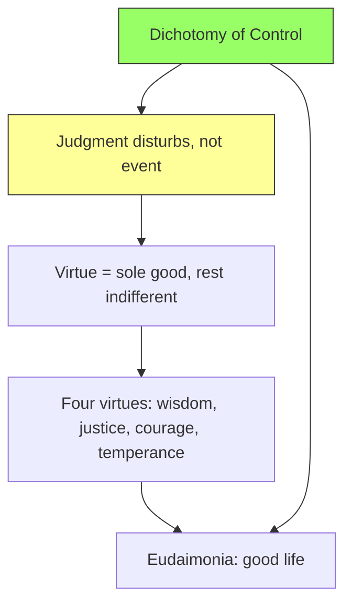

# Goal
Understand Stoicism as big life philosophy: what it says the good life is and how to get there.

- [[01 Dichotomy of control]]
- [[02 Judgment not event]]
- [[03 Virtue sole good]]
- [[04 Four virtues]]
- [[05 Eudaimonia]]

Status: node A already known. Starting node B.
